# UMAIZA WASEEM

**BSSE-5A**

**FA24B1-SE-083**

## Task 1: Install Gitea and Push a Repository from the Ubuntu Server

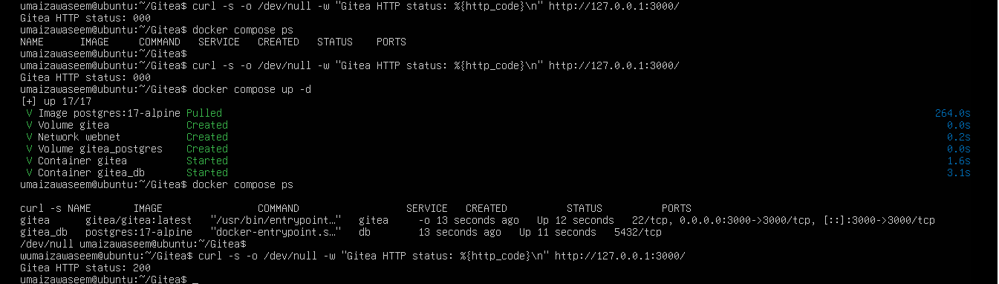

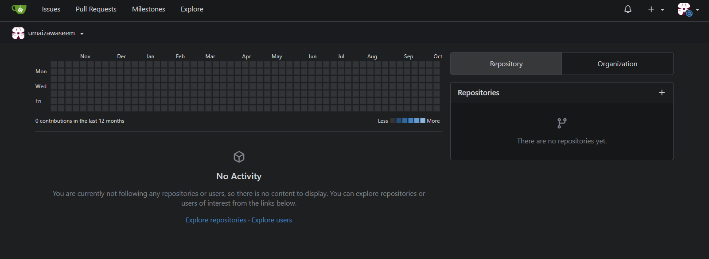

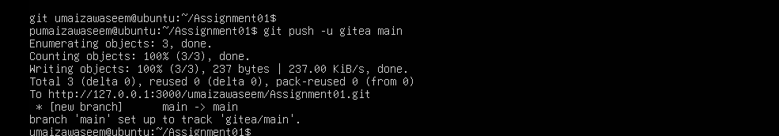

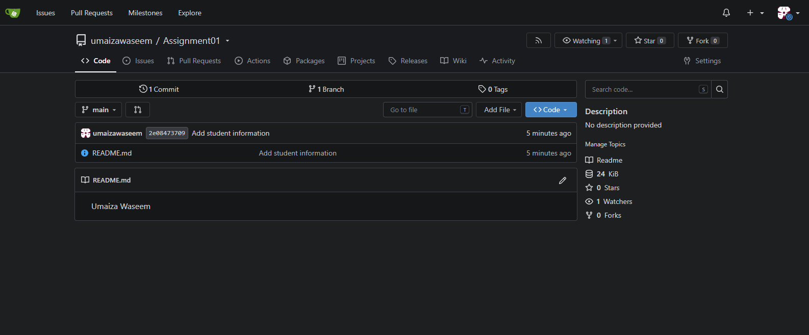

## Task 2: Push the Same Repository to GitHub

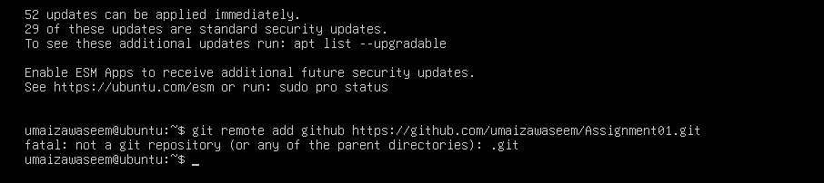

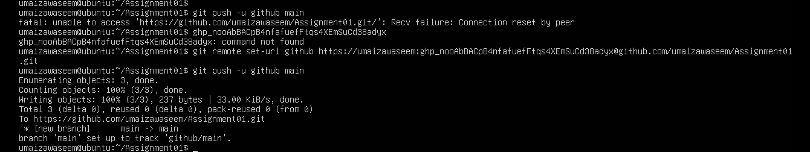

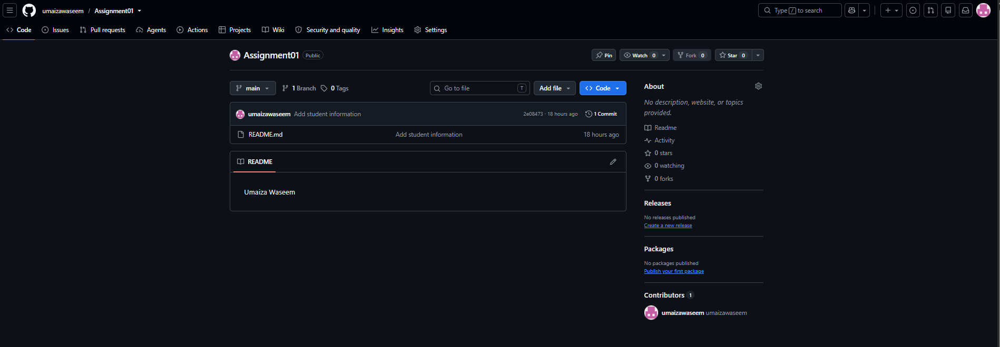

## Task 3: Track Three Large Files with Git LFS

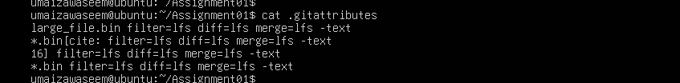

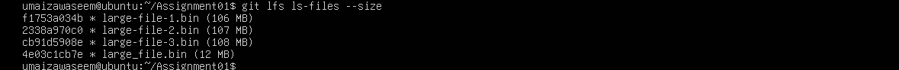

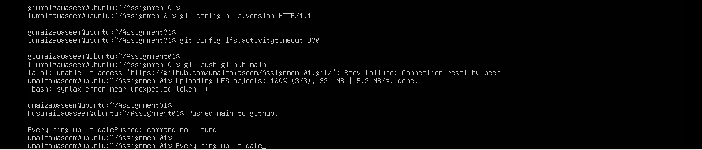

## Task 4: Create a Portfolio or CV with GitHub Pages

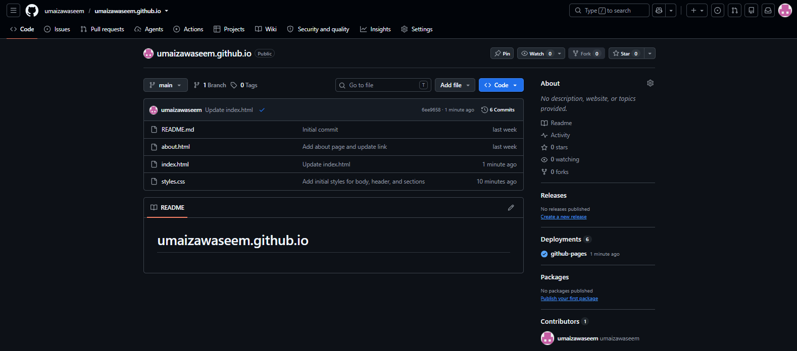

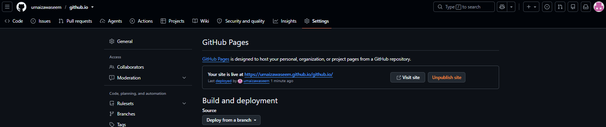

